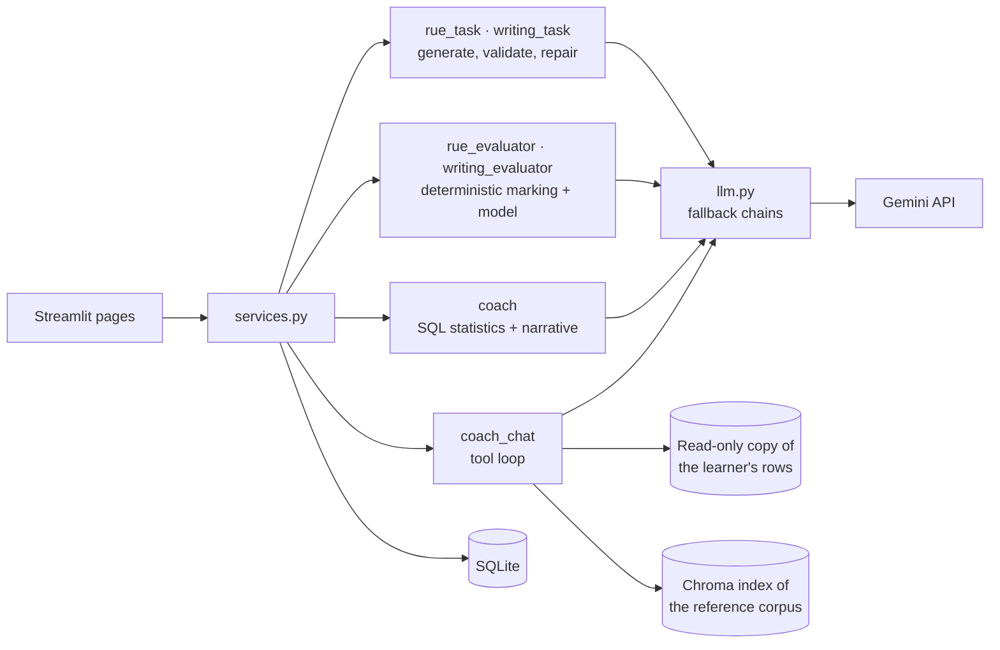

# C1 Advanced Trainer


An AI tutor for the Cambridge **C1 Advanced** exam. It writes practice material for all eight
parts of Reading and Use of English and both Writing tasks, marks it the way the exam does,
and keeps a record of every mistake so it can tell the learner what to work on next.

Every mistake is tagged with a category from a closed error taxonomy, so weaknesses add up
across parts and over time. New exercises are aimed at them, and a coach explains the
learner's progress in plain language. The app is designed to run on **free** model tiers.

## Contents

- [Features](#features)
- [How it works](#how-it-works)
- [Tech stack](#tech-stack)
- [Getting started](#getting-started)
- [Configuration](#configuration)
- [Reference corpus](#reference-corpus)
- [Project structure](#project-structure)
- [Testing](#testing)
- [Evaluation](#evaluation)
- [Limitations](#limitations)
- [Data and privacy](#data-and-privacy)
- [Disclaimer](#disclaimer)

## Features

- **Reading and Use of English**: practise any of the eight parts. Each exercise is written
  for you, aimed at your recurring mistakes, and marked item by item with the passage shown
  beside the corrections.
- **Writing**: a Part 1 essay or a Part 2 letter or email, proposal, report or review,
  marked 0-5 on the four official subscales, with errors highlighted in your script and a
  band-5 rewrite.
- **Mock exam**: either paper or both, against the real 90-minute clock. When time runs
  out, the paper is handed in as it stands.
- **Progress**: accuracy per part, recurring mistakes, Writing subscales and mock exam
  results over time, with an estimated Cambridge Scale score and a written review.
- **Coach chat**: questions about your results or about English and the exam, answered
  from your own record and from an indexed reference corpus, with citations.

## How it works



The pages only talk to `services.py`, which runs six LangGraph graphs
([`src/cae/graphs/`](src/cae/graphs/)):

| Graph | Flow |
|---|---|
| `rue_task` | `plan_task → generate → validate → critique → persist`, with `repair` looping back to `validate` |
| `rue_evaluator` | `normalise → score → [adjudicate] → tag_errors → summarise` |
| `writing_task` | `plan_task → generate → validate → persist`, with `repair` looping back to `validate` |
| `writing_evaluator` | four subscale assessors and error annotation in parallel `→ aggregate → improve` |
| `coach` | `load_stats → detect_trend → narrate → assemble → cache` |
| `coach_chat` | `load_context → respond ⇄ tools` |

Design principles:

- **Validate and repair.** Generated material is checked by deterministic validators whose
  messages are fed back to the model; Parts 5-8 also go through a model critique.
- **Deterministic marking first.** A perfect script is marked with no API calls, and so is
  any Reading part (5-8). The model only adjudicates near misses in Parts 2-4 and
  categorises dropped marks.
- **Independent subscales.** Each Writing subscale is assessed in its own concurrent call,
  so strength in one cannot inflate another. A script outside 220-260 words scores zero
  with no model call.
- **Grounded coaching.** Statistics come from SQL; the model only writes prose about
  figures it is handed. The chat answers questions about the learner's record by writing
  its own SQL, run against a read-only in-memory copy holding only the signed-in learner's
  rows, and searches the vector index for questions about the language.
- **Closed taxonomy.** Every error is tagged with an `ErrorCategory` from
  [`domain/taxonomy.py`](src/cae/domain/taxonomy.py): eight language categories shared by
  Use of English and Writing (which adds register and punctuation), and one fixed category
  per Reading part.
- **One exam specification.** [`domain/parts.py`](src/cae/domain/parts.py) defines item
  counts, marks and formats for prompts, validators, renderers and scoring.

## Tech stack

| Area | Tools |
|---|---|
| Interface | Streamlit, Altair |
| Orchestration | LangGraph, LangChain |
| Models | Google Gemini (free tier) behind a fallback router |
| Storage | SQLite with SQLAlchemy; Chroma for vector search |
| Authentication | bcrypt-hashed passwords |
| Observability | LangSmith (optional) |
| Testing | pytest, Streamlit `AppTest` |

## Getting started

### Prerequisites

- A Gemini API key, free from [Google AI Studio](https://aistudio.google.com/apikey)
- Either Docker, or Python 3.11 or newer

### With Docker

```bash
git clone <repo-url> cae-trainer
cd cae-trainer
cp .env.example .env                                   # then set GOOGLE_API_KEY
docker compose up -d --build
docker compose run --rm app python scripts/build_index.py   # optional: index the reference corpus
```

Open http://localhost:8501. The image installs the exact versions in `uv.lock`, and
`data/` is mounted from the host, so the database, the index and any reference material
you add survive rebuilds. Any script runs the same way: `docker compose run --rm app python
scripts/check_models.py`.

### Without Docker

With [uv](https://docs.astral.sh/uv/), which installs the locked versions:

```bash
git clone <repo-url> cae-trainer
cd cae-trainer
uv sync --extra dev
source .venv/bin/activate          # Windows: .venv\Scripts\activate
```

Or with pip, which resolves the ranges in `pyproject.toml` afresh:

```bash
python -m venv .venv
source .venv/bin/activate          # Windows: .venv\Scripts\activate
pip install -e ".[dev]"
```

### Setup

```bash
cp .env.example .env               # then set GOOGLE_API_KEY
python scripts/check_models.py     # optional: call every model the app will use
python scripts/build_index.py      # optional: index the reference corpus for the coach
```

### Run

```bash
streamlit run app.py
```

Open http://localhost:8501, create an account and start practising. The SQLite database is
created on first run in `data/cae.db`.

## Configuration

Settings are read from `.env`:

| Variable | Default | Purpose |
|---|---|---|
| `GOOGLE_API_KEY` | | Gemini: every model in the default chains and the embeddings |
| `CAE_GENERATION_MODEL` | `gemini-3.1-flash-lite` | Writes Reading exercises and Writing tasks |
| `CAE_MARKING_MODEL` | `gemini-3.6-flash` → `gemini-3.7-flash` → `gemini-3.8-flash` → `gemini-3.1-flash-lite` | Marks Reading (near misses, error tagging) and Writing (subscales, annotation, rewrite) |
| `CAE_COACH_MODEL` | `gemini-3.5-flash-lite` | Writes the progress review and answers in the coach chat |
| `CAE_EMBEDDING_MODEL` | `gemini-embedding-001` | Indexes the reference corpus (one model, no chain) |
| `CAE_DATABASE_URL` | `sqlite:///data/cae.db` | Any SQLAlchemy URL |
| `CAE_MAX_GENERATION_ATTEMPTS` | `3` | Repair rounds before generation gives up |
| `LANGSMITH_TRACING`, `LANGSMITH_API_KEY` | off | Optional LangSmith tracing |

Each model setting is a **fallback chain**: `provider:model` entries, first choice first,
separated by commas (see `.env.example`). A model whose daily allowance is spent is skipped
for an hour, one that is down or too slow for five minutes, and one that returns an
unreadable answer only for that call. A
chain of one model has nothing to fall back on, so when it is unavailable that job waits.
The router also supports Mistral and Groq models.

The defaults were chosen from the evaluation suites:

- **Generation** runs on Flash-Lite alone: the prompts and validators already constrain the
  material tightly, so a more capable model adds little, and Flash-Lite's limits are high.
- **Marking** leads with the most capable Flash models, because it is a deliberate
  judgement; Flash-Lite comes last so marking still answers when they are spent.
- **Coaching** runs on Flash-Lite alone: it makes many requests a day and must be fast,
  and it did well in both coach suites.

## Reference corpus

The coach answers questions about the exam and the language from Markdown or plain-text
files in `data/reference/`. `c1_advanced_structure.md`, an overview of the four papers, is
included; add your own documents there, structured with headings, and rebuild the index.

```bash
python scripts/build_index.py --dry-run   # chunk and count tokens, without embedding
python scripts/build_index.py             # embed and persist to data/chroma/
python scripts/build_index.py --check     # inspect the current index
```

Without an index the app still runs, but the coach has nothing to cite.

## Project structure

```
app.py                   Streamlit entry point
pages/                   Streamlit pages
src/cae/
  config.py              settings and model chains
  llm.py                 model router: fallback, retries, quota handling
  services.py            the only module the pages call
  auth.py                registration and sign-in
  domain/                exam specification, taxonomy, scoring, answer matching
  schemas/ prompts/ graphs/
                         one module per job: rue_task, rue_evaluator, writing_task,
                         writing_evaluator, coach, coach_chat
  validators/            structural checks for generated material
  rag/                   corpus ingestion and vector search
  db/                    SQLAlchemy models, queries and the chat's read-only sandbox
  ui/                    renderers, feedback and charts
scripts/                 model check, smoke test, index build, evaluation runner
evals/                   evaluation metrics, suites and datasets
tests/                   offline test suite
data/reference/          reference corpus for the coach
```

## Testing

```bash
pytest                                                    # offline: the model is stubbed
python -m pyflakes app.py pages src scripts tests evals
```

The test suite makes no API calls and also runs on every push through GitHub Actions. It
drives the real Streamlit pages with `AppTest`: every Reading part is answered from its own
key through the interface and must score full marks.

These scripts call the real APIs:

```bash
python scripts/smoke_test.py --all-parts          # generate and validate all eight parts
python scripts/smoke_test.py --grade              # generate, then mark right and wrong answers
python scripts/smoke_test.py --writing [--weak]   # assess the strong or weak sample script
```

## Evaluation

Six suites measure each graph against labelled datasets in `evals/datasets/`:

| Suite | What it measures |
|---|---|
| `generation` | Reading exercises from fixed seeds: validity after repair, attempts and answer-key consistency |
| `writing_task` | Writing tasks: validity and the repairs each one needed |
| `marking` | Reading marking on hand-labelled near misses: adjudication and error-category accuracy |
| `writing_evaluator` | Band accuracy per subscale and genre, and annotation recall and precision |
| `coach` | Progress reviews for synthetic learners, scored by an LLM judge against a reference review |
| `chat` | Coach chat answers for synthetic learners: tool use, plus an LLM judge's verdict |

```bash
python scripts/run_evals.py --suite marking --group 1   # one suite, one group of cases
python scripts/run_evals.py --help                      # every option
```

Reports are written to `evals/reports/` and can be uploaded to LangSmith with `--upload`.
The `coach` and `chat` suites are scored by a paid judge model, which needs
`OPENAI_API_KEY` and `pip install -e ".[evals]"`; `--no-judge` skips it, and the app itself
never uses it.

## Limitations

- **Scale scores are estimates.** Cambridge does not publish raw-to-scale tables, so the
  app interpolates between the published grade boundaries (142-210). It covers Reading and
  Use of English and Writing only, not Listening or Speaking.
- **Part 4 half marks** approximate Cambridge's unpublished split: key word used correctly
  and most of the required wording present.
- **Marking is a model's judgement**, not an official Cambridge mark.
- **Generation takes time.** Part 4 and the Reading parts (5-8) often need a repair round
  before they pass validation.

## Data and privacy

- Accounts and results are stored in the local SQLite database; passwords are hashed with
  bcrypt.
- Answers, Writing scripts and chat messages are sent to the Gemini API to be marked. On
  the free tier, Google may use what it is sent to improve its models; the app says so at
  sign-up.
- SQL written by the coach chat runs only against an in-memory, read-only copy of the
  signed-in learner's own rows, never against the application database.

## Disclaimer

This is an independent project. It is not affiliated with, endorsed by or connected to
Cambridge University Press & Assessment. The exam's name is used only to describe the exam
the material prepares for. All practice material is generated by the app; no past papers
are included.
